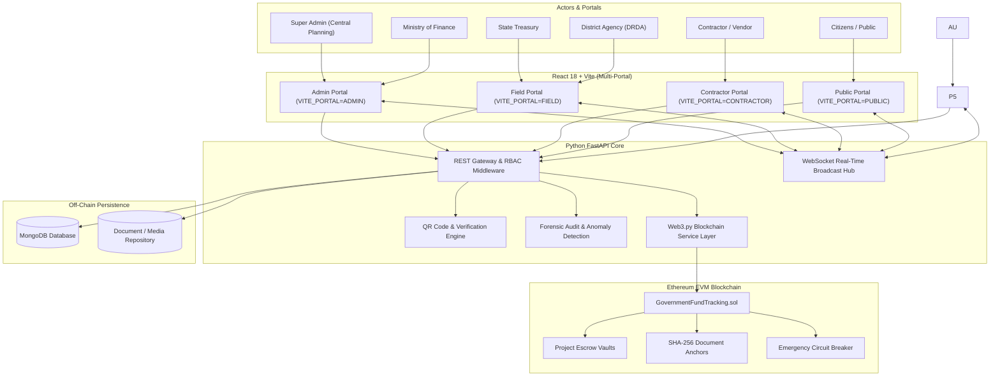

# 🏛️ Government Fund Allocation and Tracking System over Blockchain (PFMS 2.0)

[](https://opensource.org/licenses/MIT)
[](https://soliditylang.org/)
[](https://fastapi.tiangolo.com/)
[](https://python.org/)
[](https://react.dev/)
[](https://vitejs.dev/)
[](https://sepolia.etherscan.io/)
[](https://www.mongodb.com/)
[](https://web3py.readthedocs.io/)

A next-generation, multi-tier, decentralized governance and public financial management platform (PFMS 2.0). Built on **Ethereum Smart Contracts**, **Python FastAPI**, and **React 18**, this system eliminates financial leakages, eradicates ghost projects, automates milestone-based escrow payouts, and empowers citizens and administrative inspectors with tamper-proof, real-time auditability.

---

## 📑 Table of Contents

- [🌟 System Highlights & Key Features](#-system-highlights--key-features)
- [🏗️ Architectural Architecture & Data Flow](#️-architectural-architecture--data-flow)
- [🌐 Multi-Portal Architecture](#-multi-portal-architecture)
- [⛓️ Smart Contract & Sepolia Testnet Details](#️-smart-contract--sepolia-testnet-details)
- [📂 Project Directory Structure](#-project-directory-structure)
- [🧰 Technology Stack](#-technology-stack)
- [🔄 End-to-End Fund Devolution Workflow](#-end-to-end-fund-devolution-workflow)
- [🚀 Quick Start & Installation](#-quick-start--installation)
  - [Prerequisites](#1-prerequisites)
  - [⚡ One-Click Start (Windows)](#-one-click-start-windows)
  - [Manual Step-by-Step Setup](#manual-step-by-step-setup)
- [🔑 Pre-Seeded Demonstration Accounts](#-pre-seeded-demonstration-accounts)
- [🧪 Simulation Scripts & Automated Test Suite](#-simulation-scripts--automated-test-suite)
- [☁️ Cloud Deployment Guide (Render & Vercel)](#️-cloud-deployment-guide-render--vercel)
- [🔒 Security, Cryptography & Governance](#-security-cryptography--governance)
- [📄 License & Technical Glossary](#-license--technical-glossary)

---

## 🌟 System Highlights & Key Features

- 🔐 **Cryptographic Immutability**: All sanctions, state transfers, district sub-allocations, escrow vaults, and milestone disbursals are anchored on an EVM-compatible smart contract (`GovernmentFundTracking.sol`).
- 🏛️ **Hierarchical 3-Stage Fund Flow**:
  1. **Central Ministry & Finance**: Scheme creation, national budget allocation, and fund release to State Treasuries.
  2. **State Treasury**: State quota receipt, oversight, and sub-allocation to District Implementing Agencies (DRDA).
  3. **District Implementing Agency**: Project creation, geo-location boundaries, contractor selection, milestone verification, and escrow disbursals.
- 📦 **Milestone-Based Escrow Release**: Public funds are locked in smart contract escrow vaults. Payments are auto-released only after contractors upload geo-tagged photographic evidence, invoice digests, and district officers complete physical inspections.
- 📱 **Universal Public QR Code Verification**: Automatically generates a unique cryptographic QR code for each accepted contract. On-site signboards and invoices allow citizens and inspectors to scan and view real-time fund flows, progress photos, and verified on-chain transactions without authentication.
- 🛑 **Emergency Circuit Breaker (Project Freeze)**: Super Admins and Finance Authorities can instantly freeze project funds on-chain upon detecting irregularities, budget overruns, or contractor non-compliance.
- 📡 **Real-Time WebSocket Synchronization Hub**: Multi-device, cross-laptop synchronization propagates project approvals, fund releases, and milestone claims instantaneously.
- 🏦 **Masked Bank Account & Escrow Management**: Statutory masking (`XXXX XXXX 1234`) with strict IFSC validation for all government treasury departments and vendor accounts.
- 📢 **Public Transparency & Citizen Grievance Redressal**: Open public ledger to inspect schemes, projects, and expenditures with an integrated civic grievance mechanism featuring GPS geotagging and reference tracking.

---

## 🏗️ Architectural Architecture & Data Flow

The platform utilizes a **Hybrid On-Chain / Off-Chain Architecture**:
- **On-Chain (Ethereum EVM)**: Enforces financial ceilings, multi-tier balances, escrow locks, role verification, and SHA-256 evidence integrity digests.
- **Off-Chain (MongoDB + FastAPI)**: Stores high-volume operational metadata, contractor KYC records, PDF invoices, geo-tagged imagery, and real-time activity logs.



---

## 🌐 Multi-Portal Architecture

The frontend is dynamically compartmentalized into **4 distinct dedicated portals** using the `VITE_PORTAL` build/runtime configuration:

| Portal Type | Target Stakeholders | Primary Modules & Permissions |
|:---|:---|:---|
| **`ADMIN`** | Cabinet Secretariat, Super Admin, Ministry of Finance | Scheme Creation, FY Budget Allocation, Department Ceilings, Fund Devolution to States, User Management, Global Monitoring |
| **`FIELD`** | State Treasuries, District Implementing Agencies (DRDA) | State Fund Receipt, District Sub-Allocations, Project Setup, Contractor Tendering, Physical Milestone Inspection, Escrow Release |
| **`CONTRACTOR`** | Registered Concessionaires & Infrastructure Vendors | Vendor Registration, KYC Submission (GST/PAN/License), Tender Acceptance, QR Access, Milestone Proof Upload (Geo-Photos, Invoices), Payment Claims |
| **`PUBLIC`** | Citizens, Media, Civic Watchdogs *(No Login Required)* | National Scheme Explorer, District Expenditure Ledgers, Universal QR Code Scanner (`/verify/:qrId`), Public Grievance Filing & Tracking |

> **Dynamic Switcher**: In development or unified hosting, navigate to any portal via query parameter (e.g. `http://localhost:5173/?portal=CONTRACTOR` or `?portal=FIELD`).

---

## ⛓️ Smart Contract & Sepolia Testnet Details

The contract `GovernmentFundTracking.sol` is compiled under Solidity `0.8.24` and deployed on the **Ethereum Sepolia Public Testnet**.

| Parameter | Network Details |
|:---|:---|
| **Contract Name** | `GovernmentFundTracking` |
| **Network** | Ethereum Sepolia (Chain ID: `11155111`) |
| **Deployed Address** | [`0x103cdC78636491B20deadC5574755Bbd64B119c6`](https://sepolia.etherscan.io/address/0x103cdC78636491B20deadC5574755Bbd64B119c6) |
| **Deployment Transaction** | [`0x001429b80bd5e236806d8c902a1ec47c035040b542dc40a523ade5ac3967ddc6`](https://sepolia.etherscan.io/tx/0x001429b80bd5e236806d8c902a1ec47c035040b542dc40a523ade5ac3967ddc6) |
| **Role Initialization Tx** | [`0x74903381319807203deab858548127d9a354458b9f85b8dc1e2b9c9a2f81da73`](https://sepolia.etherscan.io/tx/0x74903381319807203deab858548127d9a354458b9f85b8dc1e2b9c9a2f81da73) |
| **Solidity Version** | `^0.8.24` (Optimizer enabled, 1 run) |
| **Default Deployer / Admin** | `0xeCcD57EfadFCc6217a21Bf482FEBe18c9F3D6148` |

### Core Smart Contract Data Structures
- `BudgetAllocation`: Central sanction caps, department allocations, and state devolution ceilings.
- `StateTransfer`: Multi-tier transfer records tracking fund dispersal from Centre to State Treasuries.
- `DistrictAllocation`: Quota allocation limits from State to District DRDAs.
- `ProjectEscrow`: Locks project budgets, assigns contractor address, tracks milestone indices, and enforces freeze states.
- `Milestone`: Stores progress percentage, SHA-256 proof hash, payout release boolean, and timestamp.
- `DocumentHashRecord`: Anchors cryptographic digests of contracts, invoices, and inspection certificates.
- `ForensicAuditReport`: CAG compliance score (0–100) and binding verdict on-chain.

---

## 📂 Project Directory Structure

```
GOVTFUND/
├── backend/
│   ├── app.py                     # FastAPI server application & middleware configuration
│   ├── audit_service.py           # Anomaly detection & forensic auditing engine
│   ├── auth_middleware.py         # JWT tokens & RBAC route security decorators
│   ├── bank_account_service.py    # Masked bank accounts & escrow validation
│   ├── blockchain_service.py      # Web3.py wrapper for smart contract transactions
│   ├── database.py                # MongoDB connections, indexes, and BSON serialization
│   ├── qr_service.py              # QR code generation & public verification handler
│   ├── realtime_manager.py        # WebSocket multi-client synchronization hub
│   ├── reconciliation_service.py  # Ledger verification and escrow balance reconciliation
│   ├── seed_data.py               # Automated database seed (Users, Schemes, Projects)
│   ├── simulate_real_example.py   # Full 7-stage end-to-end execution simulation script
│   ├── simulate_live_project.py   # Live project lifecycle test simulation
│   ├── config/
│   │   ├── contract_info.hosted.json  # Verified Sepolia contract address & ABI
│   │   └── contract_info.json         # Local Ganache/Hardhat contract configuration
│   ├── routes/
│   │   ├── admin_routes.py        # Central planning, FY, schemes & budget allocations
│   │   ├── auth_routes.py         # Registration, authentication & session profile
│   │   ├── blockchain_routes.py   # Diagnostics, gas stats & contract telemetry
│   │   ├── contractor_routes.py   # Project acceptance, claims & proof submissions
│   │   ├── district_routes.py     # District projects, tendering & milestone disbursals
│   │   ├── evidence_routes.py     # SHA-256 document uploads & hash anchoring
│   │   ├── finance_routes.py      # Ministry of Finance fund devolution to states
│   │   ├── notification_routes.py # In-app notification center
│   │   ├── public_routes.py       # Open public ledger, QR verification & grievances
│   │   ├── state_routes.py        # State treasury allocations to district agencies
│   │   └── transaction_routes.py  # Virtual bank accounts & transaction ledger
│   ├── tests/                     # 17 comprehensive test suites (Phase 1 to 5)
│   ├── requirements.txt           # Python backend dependencies
│   └── Procfile                   # Cloud web process entrypoint for Render
├── blockchain/
│   ├── contracts/
│   │   └── GovernmentFundTracking.sol # Solidity multi-tier governance smart contract
│   ├── scripts/
│   │   └── deploy_sepolia.js      # Robust Sepolia deployment and role initialization
│   ├── hardhat.config.js          # Hardhat configuration (Solidity 0.8.24)
│   └── package.json               # Hardhat & Ethereum dependencies
├── frontend/
│   ├── src/
│   │   ├── App.jsx                # Dynamic multi-portal routing & route guards
│   │   ├── components/            # Reusable UI components, modals, toggles & badges
│   │   ├── config/                # Portal configuration & route definitions
│   │   ├── context/               # Global state (Auth, Theme, Realtime, Notifications)
│   │   ├── pages/
│   │   │   ├── admin/             # Central Admin & Monitoring dashboards
│   │   │   ├── contractor/        # Contractor KYC, assigned projects & payment claims
│   │   │   ├── district/          # District Agency projects, tenders & verification
│   │   │   ├── finance/           # Finance Ministry fund release dashboards
│   │   │   ├── portals/           # Dedicated portal login & landing pages
│   │   │   ├── public/            # Citizen Explorer, QR Verification & Grievances
│   │   │   └── state/             # State Treasury received funds & sub-allocations
│   │   ├── services/              # Axios REST API gateway & Web3 client wrappers
│   │   └── index.css              # Cyberpunk-GovTech glassmorphism design system
│   ├── package.json               # React 18, Vite & dependencies
│   ├── vercel.json                # Vercel deployment & cache optimization configuration
│   └── vite.config.js             # Vite configuration with host bindings
├── Government_Fund_Blockchain_Technical_Terms.pdf # Exhaustive 18-page architectural manual
├── render.yaml                    # Infrastructure-as-code deployment definition for Render
├── run_project.bat                # Windows one-click launcher for FastAPI + Vite
└── README.md                      # Comprehensive project documentation
```

---

## 🧰 Technology Stack

### Blockchain Layer
- **Smart Contract Language**: Solidity `^0.8.24`
- **Development Framework**: Hardhat `2.22+` with `@nomicfoundation/hardhat-toolbox`
- **Target Networks**: Ethereum Sepolia Testnet (Hosted) & Ganache / Hardhat Node (Local)
- **Web3 Integrations**: `web3.py` (v6.0+) on backend, `ethers.js` (v6.13+) on frontend

### Backend Gateway & Middleware
- **Framework**: Python 3.10+ / 3.11+, **FastAPI** `0.110+`, **Uvicorn**
- **Authentication**: JWT (JSON Web Tokens) with `HMAC-SHA256` (HS256) & `bcrypt`
- **Concurrency & Real-time**: Native asynchronous WebSockets (`/ws`), asyncio
- **Media & Document Processing**: `qrcode[pil]`, `Pillow`, `python-multipart`
- **Database Engine**: MongoDB (Local v6.0+ or MongoDB Atlas Cloud) via `pymongo`

### Frontend User Interface
- **Framework & Bundler**: React `18.3+`, Vite `6.0+`
- **Routing**: `react-router-dom` `v6.28` with protected route guards
- **Styling**: Vanilla Modern CSS with Glassmorphism, backdrop-blur, cyber-slate palettes, and Dark/Light modes
- **Icons**: `lucide-react`
- **HTTP Client**: `axios` with interceptors and automatic loopback recovery

---

## 🔄 End-to-End Fund Devolution Workflow

The complete lifecycle for public development works follows 7 strict programmatic stages:

```
[ Central Ministry ]
       │
       ▼  Step 1: Sanction Scheme Budget on-chain (allocateBudget)
[ Ministry of Finance ]
       │
       ▼  Step 2: Release State Quota on-chain (transferToState)
[ State Treasury (e.g. Karnataka) ]
       │
       ▼  Step 3: Sub-allocate to District DRDA on-chain (allocateToDistrict)
[ District Implementing Agency (e.g. Belagavi) ]
       │
       ▼  Step 4: Create Project, define milestones & deploy Escrow (createProjectEscrow)
[ Contractor (e.g. Apex Infra Ltd) ]
       │
       ▼  Step 5: Accept contract, generate QR code, execute work & submit proofs (submitMilestoneProgress)
[ District Physical Inspection ]
       │
       ▼  Step 6: Officer verifies inspection & authorizes smart release (releaseMilestonePayment)
[ Payment Disbursed to Contractor Escrow Account ]
       │
       ▼  Step 7: Continuous Citizen QR Auditing & CAG Forensic Oversight
[ Public Ledger & Etherscan Verification ]
```

---

## 🚀 Quick Start & Installation

### 1. Prerequisites
- **Node.js**: v18.x or v20.x ([Download Node.js](https://nodejs.org/))
- **Python**: v3.10 or v3.11 ([Download Python](https://python.org/))
- **MongoDB**: Local MongoDB community server running on port `27017` or a MongoDB Atlas connection string
- **Local Blockchain (Optional)**: Ganache on port `7545` or Hardhat Node on port `8545` (The system also connects to Ethereum Sepolia)

---

### ⚡ One-Click Start (Windows)

If you are on Windows, simply double-click or run:
```cmd
run_project.bat
```
This batch script activates the Python virtual environment, launches the FastAPI server on `http://localhost:5000`, and starts the React Vite frontend on `http://localhost:5173`.

---

### Manual Step-by-Step Setup

#### Step 1: Smart Contracts (Blockchain)
```bash
cd blockchain
npm install

# Compile contracts
npx hardhat compile

# (Option A: Deploy to local Hardhat node)
# npx hardhat node
# npx hardhat run scripts/deploy_sepolia.js --network localhost

# (Option B: Deploy to Ethereum Sepolia Testnet)
# Configure SEPOLIA_RPC_URL and SEPOLIA_DEPLOYER_PRIVATE_KEY in blockchain/.env
npx hardhat run scripts/deploy_sepolia.js --network sepolia
```

#### Step 2: Backend (Python FastAPI)
```bash
cd ../backend

# Create and activate virtual environment
# Windows:
python -m venv venv
.\venv\Scripts\activate

# Linux / macOS:
# python3 -m venv venv
# source venv/bin/activate

# Install dependencies
pip install -r requirements.txt

# Configure environment variables
# Copy .env.example to .env and adjust variables as needed
cp .env.example .env
```

##### Backend `.env` Reference:
```env
PORT=5000
MONGODB_URI=mongodb://127.0.0.1:27017
MONGODB_DB_NAME=FUNDSYSTEM
JWT_SECRET=super_secret_national_pfs_blockchain_key_2026

# Blockchain Configuration (Ethereum Sepolia or Local Ganache)
ENABLE_BLOCKCHAIN=true
BLOCKCHAIN_RPC_URL=http://127.0.0.1:7545
CONTRACT_ADDRESS=0x103cdC78636491B20deadC5574755Bbd64B119c6

# Multi-Tier Department Signer Keys
FINANCE_PRIVATE_KEY=your_finance_private_key_here
STATE_PRIVATE_KEY=your_state_private_key_here
DISTRICT_PRIVATE_KEY=your_district_private_key_here
CONTRACTOR_PRIVATE_KEY=your_contractor_private_key_here
```

Start the FastAPI application:
```bash
python app.py
```
- Interactive API Documentation: [http://localhost:5000/docs](http://localhost:5000/docs)
- Alternative Redoc Documentation: [http://localhost:5000/redoc](http://localhost:5000/redoc)
- Health Check & Blockchain Diagnostics: [http://localhost:5000/api/health](http://localhost:5000/api/health)

#### Step 3: Frontend (React 18 + Vite)
```bash
cd ../frontend
npm install

# (Optional) Set specific portal mode in frontend/.env
# VITE_PORTAL=ADMIN   (Options: ADMIN, FIELD, CONTRACTOR, PUBLIC)
cp .env.example .env

# Start Vite dev server
npm run dev
```
Open [http://localhost:5173](http://localhost:5173) in your browser.

---

## 🔑 Pre-Seeded Demonstration Accounts

The database seed (`backend/seed_data.py`) automatically initializes demonstration profiles for all government administrative tiers:

| Role Identifier | Assigned Agency / Entity | Login Email | Default Password |
|:---|:---|:---|:---|
| **SUPER_ADMIN** | Cabinet Secretariat & Central Planning | `admin@govtfund.gov.in` | `Admin@123` |
| **FINANCE** | Ministry of Finance (Public Disbursal Div.) | `finance@govtfund.gov.in` | `Finance@123` |
| **STATE** | Karnataka State Treasury Department | `karnataka@govtfund.gov.in` | `State@123` |
| **STATE** | Maharashtra State Finance Department | `state@govtfund.gov.in` | `State@123` |
| **DISTRICT** | Belagavi DRDA Collectorate (Karnataka) | `district.belagavi@govtfund.gov.in` | `District@123` |
| **DISTRICT** | Pune DRDA Development Agency (Maharashtra) | `district@govtfund.gov.in` | `District@123` |
| **CONTRACTOR** | Apex Infrastructure & Civil Works Ltd. | `contractor@buildcorp.in` | `Contractor@123` |
| **CONTRACTOR** | Karnataka Highway Infra Concessionaires | `contractor.ka@infra.in` | `Contractor@123` |
| **PUBLIC** | Open Public Citizen Access | *(No credentials required)* | *N/A* |

---

## 🧪 Simulation Scripts & Automated Test Suite

### Full Real-World Simulation
Simulate the entire end-to-end lifecycle for a real highway infrastructure corridor project:
```bash
cd backend
python simulate_real_example.py
```
This automated simulation script executes:
1. Super Admin central budget sanction.
2. Ministry of Finance state devolution release.
3. State Treasury sub-allocation to district.
4. District Officer project escrow creation and milestone scheduling.
5. Contractor project acceptance and QR code issuance.
6. Milestone progress submission with SHA-256 invoice hashing.
7. Physical inspection verification and automated escrow fund release.
8. Citizen QR code verification and public grievance lodging.

### Comprehensive Test Suites (17 Suites)
Execute the complete test suite:
```bash
cd backend
pytest tests/ -v
```

Specialized workflow validation scripts:
- Bank Account & Blockchain Escrow Workflow: `python test_bank_account_blockchain_workflow.py`
- QR Acceptance & Verification Workflow: `python test_qr_acceptance_workflow.py`
- Active Blockchain Account Check: `python check_accounts.py`

---

## ☁️ Cloud Deployment Guide (Render & Vercel)

The system is configured for cloud production deployment:

### Backend Deployment (Render)
- Configured via [`render.yaml`](render.yaml)
- **Runtime**: Python `3.11.9`
- **Build Command**: `pip install -r requirements.txt`
- **Start Command**: `uvicorn app:app --host 0.0.0.0 --port $PORT`
- **Environment Variables**:
  - `APP_ENV=production`
  - `MONGODB_URI`: Your MongoDB Atlas cluster connection URI
  - `JWT_SECRET`: Random 32+ character key
  - `ENABLE_BLOCKCHAIN=true`
  - `CONTRACT_INFO_FILE=contract_info.hosted.json`
  - `CONTRACT_ADDRESS=0x103cdC78636491B20deadC5574755Bbd64B119c6`
  - `RPC_URL`: Alchemy / Infura Sepolia HTTPS JSON-RPC endpoint
  - `CORS_ORIGINS`: Comma-separated list of your Vercel domains

### Frontend Deployment (Vercel)
- Configured via [`frontend/vercel.json`](frontend/vercel.json)
- **Framework Preset**: Vite
- **Build Command**: `npm run build`
- **Output Directory**: `dist`
- **Multi-Portal Hosting**: Deploy multiple Vercel instances pointing to the same repository with different `VITE_PORTAL` environment variables:
  - Instance 1: `VITE_PORTAL=ADMIN`
  - Instance 2: `VITE_PORTAL=FIELD`
  - Instance 3: `VITE_PORTAL=CONTRACTOR`
  - Instance 4: `VITE_PORTAL=PUBLIC`
- **Backend Linkage**: Set `VITE_API_URL` to your hosted Render backend URL.

---

## 🔒 Security, Cryptography & Governance

- **Strict Separation of Duties**: Role-Based Access Control (RBAC) enforced through server-side token validation and Solidity function modifiers (`onlySuperAdmin`, `onlyFinance`, `onlyState`, `onlyDistrict`).
- **Elliptic Curve Signatures**: Ethereum `secp256k1` ECDSA signatures authenticate all on-chain transactions with EIP-55 checksum validation.
- **SHA-256 Evidence Anchoring**: Contractor milestone deliverables, geo-tagged site photographs, and PDF invoices are cryptographically hashed; only matching hashes unlock escrow disbursements.
- **Anti-Overdraft Guard**: Hardened checks (`allocated <= sanctioned ceiling` and `$expr: {$gt: ["$released_amount", "$total_budget"]}`) prevent unauthorized over-allocation.
- **Privacy Compliance**: Bank account numbers and sensitive beneficiary identifiers are masked across all public APIs and client views.

---

## 📄 License & Technical Glossary

This project is licensed under the [MIT License](LICENSE).

For an in-depth reference on all architectural terms, EVM storage layouts, cryptographic formulas, and GovTech definitions, refer to the authoritative project manual:
📄 **[`Government_Fund_Blockchain_Technical_Terms.pdf`](Government_Fund_Blockchain_Technical_Terms.pdf)**

---

*Developed for transparent, leakage-free public governance and accountable infrastructure delivery.*
